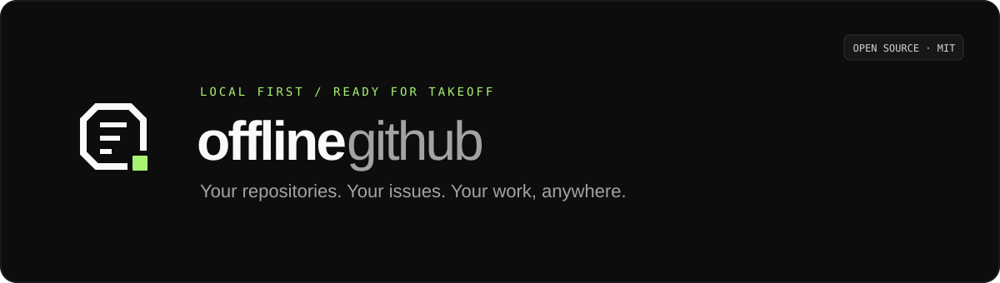
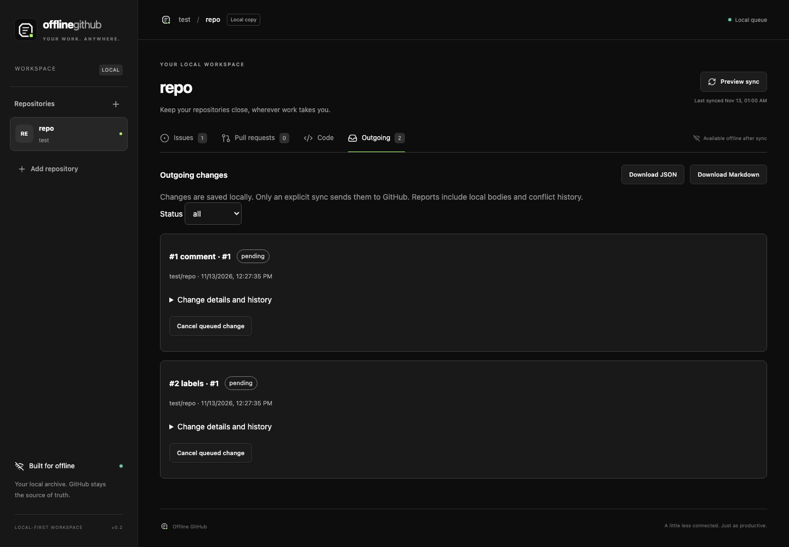
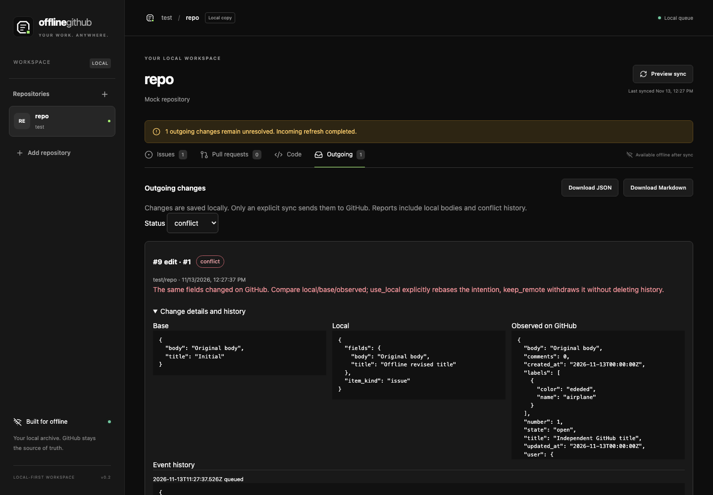
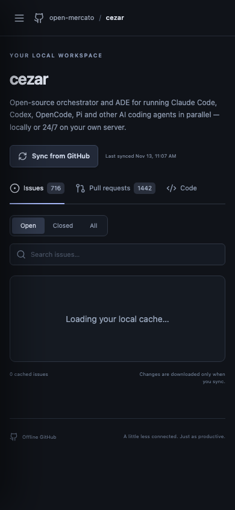

# 🛫 Offline GitHub

**Open source · MIT licensed · Local first**

Your repositories, issues and pull requests at 35,000 feet. A **Rust + React + shadcn/ui** workspace: download before boarding, read and code offline, save outgoing comments and labels locally, then review and sync when connected again. GitHub remains the source of truth.


> 🚧 Early release. Independent of GitHub. Original project logo; no GitHub logo is used.

## ✨ What you get

- 🗂️ Multiple repositories, issues/PRs searchable by text or #number, shareable local URLs, discussions and source browsing.
- 🖼️ GitHub-hosted comment screenshots downloaded on Pull and displayed offline.
- 🌳 Full Git history, branches, tags and available PR heads. Isolated worktrees for testing.
- ✍️ Offline comments, issue/PR drafts, label changes and review drafts in a durable SQLite outbox.
- 🟠 Visible pending, sending, conflicted, failed and uncertain markers beside local work.
- 🔄 Separate Pull from GitHub and reviewed Push, with conflict handling.
- 🧾 Permanent outgoing history with JSON/Markdown exports for you or an agent.
- 🤖 `ogh`: gh-shaped CLI reads, local Git operations, queued writes and an Open Mercato skill adapter.
- 🎨 Neutral black surfaces, restrained lime accents, original MIT-licensed branding, no CDN assets.

## 🚀 Getting started — one command

On **macOS or Linux**, paste this into a terminal while online:

```bash
bash <(curl -fsSL https://raw.githubusercontent.com/pkarw/offline-github/main/scripts/setup.sh)
```

🐙 Setup first asks for a GitHub repository. Press **Enter** for
**open-mercato/open-mercato**, or enter another `OWNER/REPO` or GitHub URL.
Use `--repo OWNER/REPO` to choose directly.

📂 Before installing anything, setup shows all destinations and lets you edit the
project folder (default: `~/Projects/open-mercato-offline`). Press **Enter** to
keep it, or add `--folder my-mercato` to the command to choose it directly.

The installer downloads/builds `ogh`, starts the local browser app, caches
**your selected repository** (Open Mercato by default), creates your development worktree, and installs
**open-mercato/skills** for Claude, Codex and pi with the **ogh tracker selected**.
It opens a shell **inside your project**. Run `pi`, `codex` or `claude` there
(using whichever agent you already have installed and signed into).

Your browser opens automatically. The app normally uses **http://127.0.0.1:4173**; if occupied, it chooses a free port and prints the actual URL. Next time, enter the same project with:

```bash
~/.local/bin/ogh-work
```

First run may ask you to sign into GitHub and takes several minutes to download
all issues, PRs and Git history. On macOS, missing prerequisites install through
Homebrew (install [Homebrew](https://brew.sh) first). On Linux, have Node.js 22+,
Git, GitHub CLI, jq, Python 3 and a C build toolchain installed; the installer
adds Rust if needed. The Open Mercato source is ready for agent work; running
the ERP and its databases needs [Open Mercato's own development setup](https://github.com/open-mercato/open-mercato#readme).

### 🧊 Or use Microsandbox

Keep the workspace, tools and GitHub login inside a persistent local microVM:

```bash
bash <(curl -fsSL https://raw.githubusercontent.com/pkarw/offline-github/main/scripts/sandbox.sh)
```

🐙 The sandbox asks for the repository too, defaulting to Open Mercato.
📂 It shows its destinations first and prompts for the guest
folder name (default: `/root/Projects/open-mercato-offline`). Add
`--folder my-mercato` to choose it directly. Both installers support `--plan`
to preview paths without installing anything.

The same setup runs inside [Microsandbox](https://microsandbox.dev/), then opens
a shell in the project. Your host home directory and credentials are **not mounted**.
The app opens at **http://127.0.0.1:4183**. Return later with
`~/.local/bin/ogh-sandbox`. See [sandbox details](docs/SANDBOX.md).

> Local comments, labels and PR drafts remain queued until you review and confirm Push.
> Skills use cached reads and queued writes through `ogh`; live-only claim/merge
> gates stop offline. Agents are installed/authenticated separately. No global `gh` alias.

## ⬆️ Upgrade an existing installation

Keep your existing repositories: **do not delete `~/.offline-github` or your
project folders**. First stop the running `ogh serve` with **Ctrl-C** in its
terminal. If setup started it in the background, check the PID in
`~/.offline-github/setup/server.pid` with `ps -p PID -o pid=,command=`, then
stop that specific process with `kill PID` once confirmed as your ogh server.
This ensures the browser uses the updated backend rather than a reused server.

For the default Open Mercato installation, paste:

```bash
bash <(curl -fsSL https://raw.githubusercontent.com/pkarw/offline-github/main/scripts/setup.sh) --repo open-mercato/open-mercato --folder "$HOME/Projects/open-mercato-offline" --skip-sync --no-shell
~/.local/bin/ogh --version
```

📂 Replace `--repo` and `--folder` with the repository and **existing managed
workspace** you selected during setup. If you used `OGH_DATA_DIR` or
`OGH_SETUP_ROOT`, export those same values before upgrading. One run updates the
shared CLI and UI for **all cached repositories**; it also refreshes managed agent
instructions in the selected workspace and updates `ogh-work` to enter it.

💾 Cached issues, PRs, images, outgoing history, queued changes, local commits
and worktrees remain in place. `--skip-sync` skips the repository download;
upgrading does **not Push** queued work. The installer opens the updated browser
app and prints its actual URL. Refresh any old browser tabs. Use **Pull from
GitHub** separately when you want fresh repository data.

🧊 **Microsandbox:** enter your existing VM with `~/.local/bin/ogh-sandbox`, stop
its ogh server, then run the same setup command **inside the guest**, using
`--folder /root/Projects/open-mercato-offline` (or your existing guest folder)
and prefixing it with `OGH_SETUP_PORT=4174`. Keep the same VM and persistent
volume; exit and run `~/.local/bin/ogh-sandbox` again to reopen it.

🛠️ **Installed from a source checkout?** In that checkout, run `git pull --ff-only`
then `bash scripts/install.sh`, and restart `ogh serve`. This requires the
[source-build prerequisites](docs/SETUP.md#prerequisites).

## 📚 Docs

- [Setup options, prerequisites and troubleshooting](docs/SETUP.md)
- [App and CLI guide — sync, offline work, outgoing changes and recovery](docs/GUIDE.md)
- [Microsandbox setup and persistence](docs/SANDBOX.md)
- [gh vs ogh feature parity](docs/FEATURE-PARITY.md)
- [Open Mercato skills: supported operations and limits](docs/skills-compatibility.md)
- [Offline tracker contract](docs/trackers/offline-github.md)
- [Local API](docs/API.md) · [Outgoing API and durability](docs/OUTBOX.md)

<details><summary>📸 More screenshots</summary>





*Queue/conflict screenshots use isolated test fixtures; no test changes were posted to real GitHub.*

The web UI shows the local checkout path. Use **Open ▾** to launch installed
Claude Code, Codex CLI, ogh CLI or Terminal in that checkout. Unavailable tools
are disabled; **Refresh detection** checks again after installing a tool.




</details>

## 🛠️ Development and verification

```bash
bash scripts/check.sh
# Include real browser tests with a Rust server + fake GitHub:
OGH_BROWSER_TESTS=1 bash scripts/check.sh
# UI development:
ogh serve --web-dir "$PWD/web/dist"
cd web && npm run dev
```

Checks include Rust tests/Clippy, delta-sync regressions, fake-GitHub outgoing tests, TypeScript and production UI build. The outgoing suite exercises dropped connections, uncertainty reconciliation, conflicts, queued dependencies, parallel writes, pinned branch publications and no-force behavior **without mutating real GitHub**.

REST reading and Git fetch use authenticated GitHub CLI GET calls. Explicit review preparation additionally uses the whitelisted `gh pr view` read query. Outgoing sync alone performs named API mutations and explicit fast-forward Git publication. Contracts: [local reads](docs/API.md), [outgoing queue](docs/OUTBOX.md).

**License:** [MIT](LICENSE), including original logos. GitHub is a trademark of GitHub, Inc.; this project is independent and uses no GitHub logo. Dependencies retain their own licenses.

Made for long flights and focused work ☁️

💾 App storage: `~/.offline-github` (override with `OGH_DATA_DIR`). Filter issues and PRs by label; remove projects from the app without losing local files or outgoing work. [Storage and recovery details](docs/SETUP.md#storage-and-local-project-removal).
