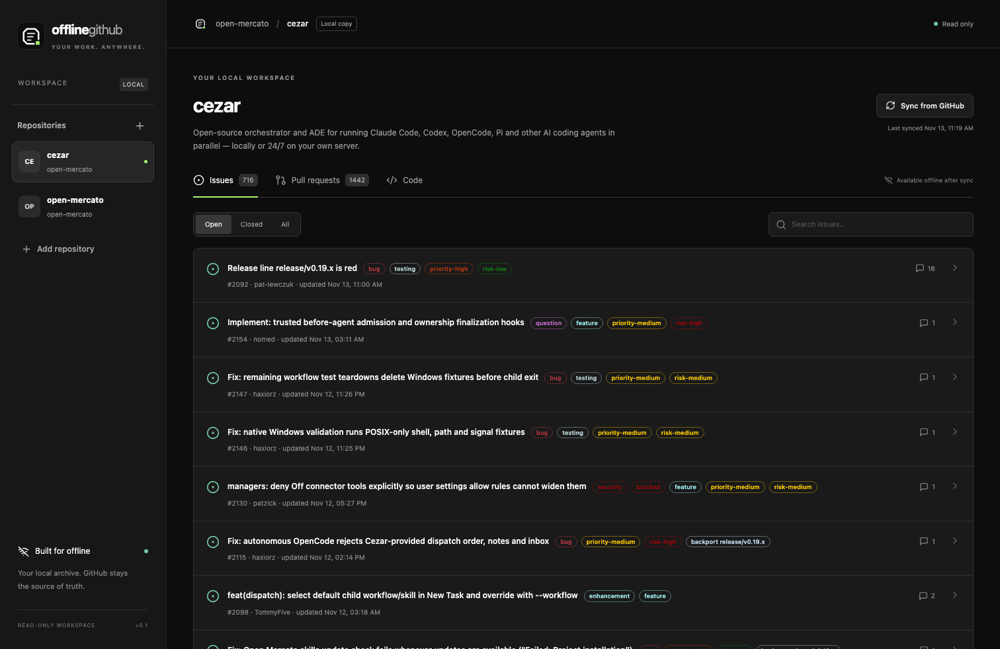
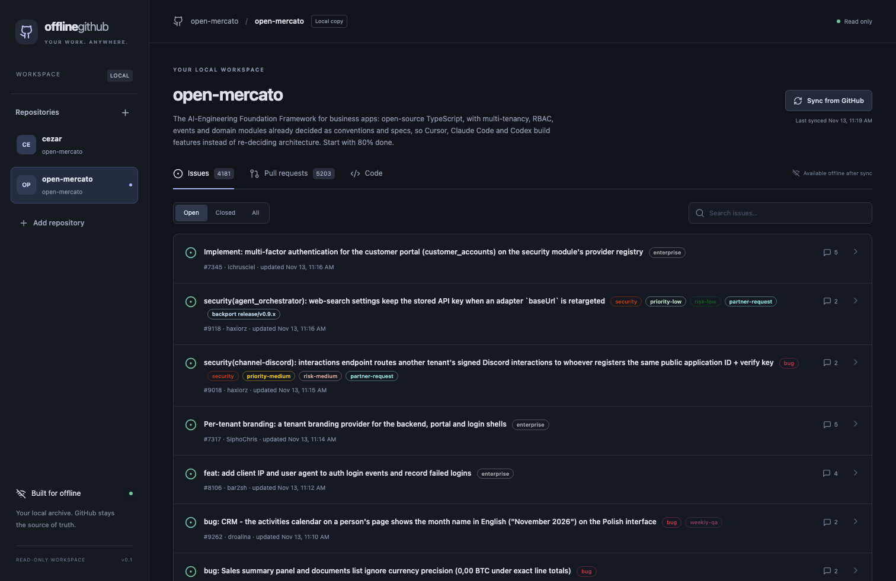
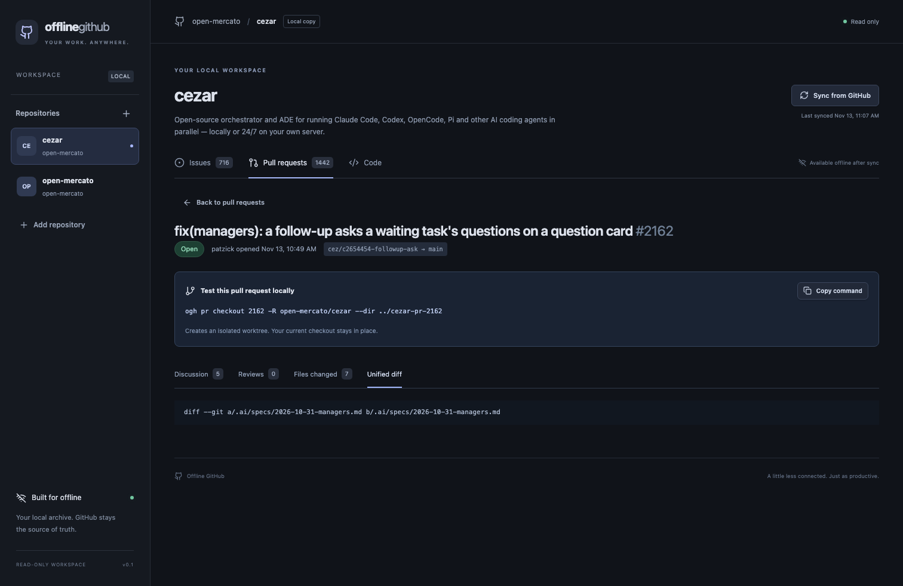
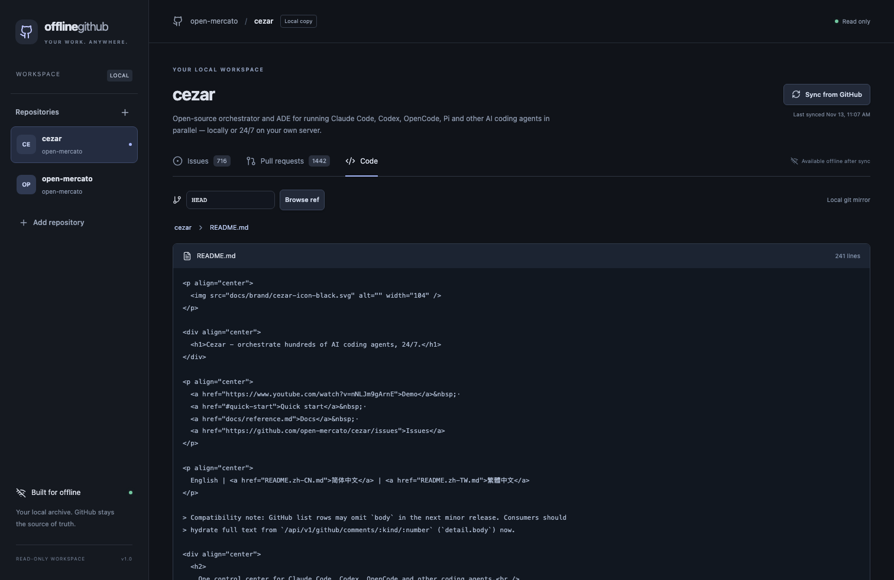

# 🛫 Offline GitHub

**Open source · MIT licensed · Local first**

Your repositories, issues and pull requests at 35,000 feet. A **Rust + React + shadcn/ui** workspace: download before boarding, read and code offline, save outgoing comments and labels locally, then review and sync when connected again. GitHub remains the source of truth.



> 🚧 Early release. Independent of GitHub. Original project logo; no GitHub logo is used.

## ✨ What you get

- 🗂️ Multiple repositories, searchable issues/PRs, discussions and local source browsing.
- 🌳 Full Git history, branches, tags and available PR heads. Isolated worktrees for testing.
- ✍️ Offline comments, issue/PR drafts, label changes and review drafts in a durable SQLite outbox.
- 🟠 Visible pending, sending, conflicted, failed and uncertain markers beside local work.
- 🔄 Explicit Sync preview, conflict handling and incoming delta sync.
- 🧾 Permanent outgoing history with JSON/Markdown exports for you or an agent.
- 🤖 `ogh`: gh-shaped CLI reads, local Git operations, queued writes and an Open Mercato skill adapter.
- 🎨 Neutral black surfaces, restrained lime accents, original MIT-licensed branding, no CDN assets.

## 🚀 Getting started — one command

On **macOS or Linux**, paste this into a terminal while online:

```bash
bash <(curl -fsSL https://raw.githubusercontent.com/pkarw/offline-github/main/scripts/setup.sh)
```

The installer downloads/builds `ogh`, starts the local browser app, caches
**open-mercato/open-mercato**, creates your development worktree, and installs
**open-mercato/skills** for Claude, Codex and pi with the **ogh tracker selected**.
It opens a shell **inside your project**. Run `pi`, `codex` or `claude` there
(using whichever agent you already have installed and signed into).

Open **http://127.0.0.1:4173**. Next time, enter the same project with:

```bash
~/.local/bin/ogh-work
```

First run may ask you to sign into GitHub and takes several minutes to download
all issues, PRs and Git history. On macOS, missing prerequisites install through
Homebrew (install [Homebrew](https://brew.sh) first). On Linux, have Node.js 22+,
Git, GitHub CLI, jq, Python 3 and a C build toolchain installed; the installer
adds Rust if needed. The Open Mercato source is ready for agent work; running
the ERP and its databases needs [Open Mercato's own development setup](https://github.com/open-mercato/open-mercato#readme).

### 🧊 Or use Microsandbox

Keep the workspace, tools and GitHub login inside a persistent local microVM:

```bash
bash <(curl -fsSL https://raw.githubusercontent.com/pkarw/offline-github/main/scripts/sandbox.sh)
```

The same setup runs inside [Microsandbox](https://microsandbox.dev/), then opens
a shell in the project. Your host home directory and credentials are **not mounted**.
The app opens at **http://127.0.0.1:4183**. Return later with
`~/.local/bin/ogh-sandbox`. See [sandbox details](docs/SANDBOX.md).

> Local comments, labels and PR drafts remain queued until you review Sync.
> Skills use cached reads and queued writes through `ogh`; live-only claim/merge
> gates stop offline. Agents are installed/authenticated separately. No global `gh` alias.

## 📚 Docs

- [Setup options, prerequisites and troubleshooting](docs/SETUP.md)
- [App and CLI guide — sync, offline work, outgoing changes and recovery](docs/GUIDE.md)
- [Microsandbox setup and persistence](docs/SANDBOX.md)
- [Open Mercato skills: supported operations and limits](docs/skills-compatibility.md)
- [Offline tracker contract](docs/trackers/offline-github.md)
- [Local API](docs/API.md) · [Outgoing API and durability](docs/OUTBOX.md)

<details><summary>📸 More screenshots</summary>




*Queue/conflict screenshots use isolated test fixtures; no test changes were posted to real GitHub.*




</details>

## 🛠️ Development and verification

```bash
bash scripts/check.sh
# Include real browser tests with a Rust server + fake GitHub:
OGH_BROWSER_TESTS=1 bash scripts/check.sh
# UI development:
ogh serve --web-dir "$PWD/web/dist"
cd web && npm run dev
```

Checks include Rust tests/Clippy, delta-sync regressions, fake-GitHub outgoing tests, TypeScript and production UI build. The outgoing suite exercises dropped connections, uncertainty reconciliation, conflicts, queued dependencies, parallel writes, pinned branch publications and no-force behavior **without mutating real GitHub**.

REST reading and Git fetch use authenticated GitHub CLI GET calls. Explicit review preparation additionally uses the whitelisted `gh pr view` read query. Outgoing sync alone performs named API mutations and explicit fast-forward Git publication. Contracts: [local reads](docs/API.md), [outgoing queue](docs/OUTBOX.md).

**License:** [MIT](LICENSE), including original logos. GitHub is a trademark of GitHub, Inc.; this project is independent and uses no GitHub logo. Dependencies retain their own licenses.

Made for long flights and focused work ☁️
